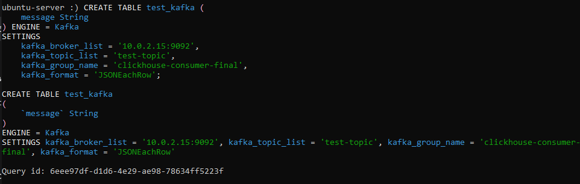
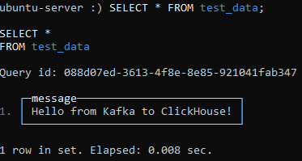

# Kafka → ClickHouse Streaming Demo

Pet-проект по настройке потоковой передачи данных из **Apache Kafka** в **ClickHouse** в реальном времени.

## 🛠 Стек технологий

- **Apache Kafka** (Docker, `confluentinc/cp-kafka:7.4.0`) — брокер сообщений.
- **ClickHouse** (системный сервис на Ubuntu) — колоночная СУБД для аналитики.
- **Docker Compose** — оркестрация Kafka и Zookeeper.

## 🚀 Что сделано

1.  **Развернут Kafka в Docker.** Настроены Zookeeper и Kafka, проброшен порт 9092.
2.  **Создан топик `test-topic`** для передачи сообщений.
3.  **Настроен ClickHouse**:
    - Создана таблица `test_kafka` с движком `Kafka` (читает сообщения из топика).
    - Создана таблица `test_data` с движком `MergeTree` (хранит данные).
    - Создан `Materialized View` `kafka_to_ch_mv`, который автоматически перекладывает данные из Kafka в `test_data`.
4.  **Проверена передача данных:** отправлено сообщение через `kafka-console-producer`, прочитано в ClickHouse через `SELECT * FROM test_data;`.

## 📸 Скриншоты



*Создание таблиц с движком Kafka и Materialized View.*



*Данные, полученные из Kafka, в таблице test_data.*

## 📂 Как запустить

```bash
# Запуск Kafka
docker compose up -d

# Создание топика
docker exec -it kafka kafka-topics --bootstrap-server localhost:9092 --create --topic test-topic --partitions 1 --replication-factor 1

# Настройка ClickHouse (в clickhouse-client)
CREATE TABLE test_kafka (message String) ENGINE = Kafka SETTINGS kafka_broker_list = '10.0.2.15:9092', kafka_topic_list = 'test-topic', kafka_group_name = 'clickhouse-consumer', kafka_format = 'JSONEachRow';
CREATE TABLE test_data (message String) ENGINE = MergeTree ORDER BY tuple();
CREATE MATERIALIZED VIEW kafka_to_ch_mv TO test_data AS SELECT * FROM test_kafka;

# Отправка сообщения
echo '{"message": "Hello from Kafka to ClickHouse!"}' | docker exec -i kafka kafka-console-producer --bootstrap-server localhost:9092 --topic test-topic

# Проверка
clickhouse-client --query "SELECT * FROM test_data;"
```

🔗 Связанные проекты
marketplace-dwh-analytics — основной DWH-проект.

greenplum-dwh-demo — демо MPP-СУБД Greenplum.
